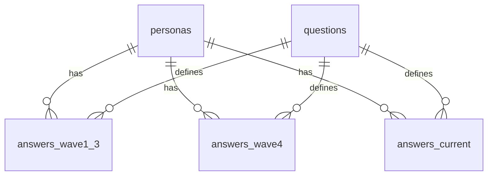

# Twin-2K-500 ingest schema

SQLite 3.x. Tables and views described here are loaded **only** from [Twin-2K-500](https://huggingface.co/datasets/LLM-Digital-Twin/Twin-2K-500): `question_catalog.json`, human response CSVs, overlap/mapping files, and the `full_persona` config.

**Objects:** 4 tables (`personas`, `questions`, `answers_wave1_3`, `answers_wave4`) and 1 view (`answers_current`).

## Conventions

| Convention | Rule |
|------------|------|
| `persona_id` | Same as dataset `pid` (string). **2,058** distinct values. |
| `item_id` | Stable key from question catalog CSV column name (`QID` or `QID_SubID`). |
| Timestamps | ISO 8601 UTC, `TEXT` stored as `YYYY-MM-DDTHH:MM:SSZ`. |
| JSON | `TEXT`; must be valid JSON where noted. |
| Booleans | `INTEGER` with `CHECK (col IN (0, 1))`. |

### Entity relationship (logical)



Human answers are **long format**: one row per `(persona_id, item_id)` per wave table. Canonical answers come from view `answers_current` (wave 4 wins when `questions.is_overlap = 1`).

---

## Table: `personas`

One row per participant. **Structured demographics** support segment filters. Simulation text is `persona_summary` from HF `full_persona`. Per-item Q&A lives in `questions` and `answers_*` / `answers_current`, not on this row.

| Property | Value |
|----------|-------|
| Grain | 1 row = 1 participant |
| Expected row count | 2,058 |
| Primary key | `persona_id` |

### Columns

| Column | Data type | PK | FK | NOT NULL | Unique | Default | Distinct / cardinality | Description |
|--------|-----------|:--:|:--:|:--------:|:------:|---------|------------------------|-------------|
| `persona_id` | `TEXT` | ✓ | | ✓ | ✓ | | 2,058 | HuggingFace `pid`. |
| `persona_summary` | `TEXT` | | | ✓ | | | high | HF `persona_summary`. |
| `region` | `TEXT` | | | | | `NULL` | ~5 | US region (e.g. South, Northeast). From demographics answers at ingest (or `answers_*` when loaded). |
| `gender` | `TEXT` | | | | | `NULL` | low | |
| `age_band` | `TEXT` | | | | | `NULL` | low | Bucketed age (e.g. `18-29`). |
| `education_level` | `TEXT` | | | | | `NULL` | low | |
| `race` | `TEXT` | | | | | `NULL` | low | |
| `us_citizen` | `INTEGER` | | | | | `NULL` | 2 | `1` = yes, `0` = no; `CHECK (us_citizen IN (0, 1))` when set. |
| `marital_status` | `TEXT` | | | | | `NULL` | low | |
| `religion` | `TEXT` | | | | | `NULL` | low | |
| `religious_attendance` | `TEXT` | | | | | `NULL` | low | |
| `political_affiliation` | `TEXT` | | | | | `NULL` | low | |
| `income_band` | `TEXT` | | | | | `NULL` | low | |
| `political_views` | `TEXT` | | | | | `NULL` | low | |
| `household_size` | `INTEGER` | | | | | `NULL` | low | |
| `employment_status` | `TEXT` | | | | | `NULL` | low | |
| `loaded_at` | `TEXT` | | | ✓ | | `datetime('now')` | — | Ingest timestamp. |
| `source_revision` | `TEXT` | | | | | `NULL` | low | HF dataset snapshot / git hash for reproducibility. |

### Indexes

| Name | Columns | Unique | Purpose |
|------|---------|:------:|---------|
| `pk_personas` | `persona_id` | ✓ | Primary key (implicit in SQLite). |
| `idx_personas_region_education` | `region`, `education_level` | | Segment analysis. |
| `idx_personas_age_income` | `age_band`, `income_band` | | Segment analysis. |

---

## Table: `questions`

One row per **scorable item** (catalog CSV column): matrix rows, sliders, and single-choice items share one `item_id` namespace.

| Property | Value |
|----------|-------|
| Grain | 1 row = 1 catalog column / answer cell |
| Expected row count | ~761 wave 1–3 items; ~127 of those were also asked in wave 4 |
| Primary key | `item_id` |

### Columns

| Column | Data type | PK | FK | NOT NULL | Unique | Default | Distinct / cardinality | Description |
|--------|-----------|:--:|:--:|:--------:|:------:|---------|------------------------|-------------|
| `item_id` | `TEXT` | ✓ | | ✓ | ✓ | | ~761+ | Catalog column name: `{QID}` or `{QID}_{SubID}`. |
| `question_id` | `TEXT` | | | ✓ | | | ~256 | Qualtrics `QuestionID` (parent question). |
| `sub_id` | `TEXT` | | | | | `NULL` | varies | Sub-item for matrix/slider; `NULL` if single column. |
| `question_text` | `TEXT` | | | | | `NULL` | | Stem text (may repeat across sub-items). |
| `item_text` | `TEXT` | | | | | `NULL` | | Row/statement text for matrix items. |
| `question_type` | `TEXT` | | | | | `NULL` | low | Catalog type (MC, Matrix, Slider, etc.). |
| `options_json` | `TEXT` | | | | | `NULL` | | JSON array of allowed labels or scale endpoints. |
| `is_overlap` | `INTEGER` | | | ✓ | | `0` | 2 | `1` if the item was asked again in wave 4. Wave 4 is a subset of wave 1–3, so `1` means both waves and `0` means wave 1–3 only. |
| `category` | `TEXT` | | | | | `NULL` | low | Paper/category label from catalog when present. |

### Indexes

| Name | Columns | Unique | Purpose |
|------|---------|:------:|---------|
| `pk_questions` | `item_id` | ✓ | Primary key. |
| `idx_questions_qid` | `question_id` | | Join / group by parent question. |
| `idx_questions_overlap` | `is_overlap` | | Wave 4 item lists and `answers_current`. |

---

## Table: `answers_wave1_3`

Human responses from waves 1–3 CSVs (`wave1_3_response.csv` / `wave1_3_response_label.csv`).

| Property | Value |
|----------|-------|
| Grain | 1 row = 1 answer (person × item) |
| Expected row count | ≤ 2,058 × ~761 (sparse cells should not be stored; only non-null answers) |
| Primary key | (`persona_id`, `item_id`) |

### Columns

| Column | Data type | PK | FK | NOT NULL | Unique | Default | Distinct / cardinality | Description |
|--------|-----------|:--:|:--:|:--------:|:------:|---------|------------------------|-------------|
| `persona_id` | `TEXT` | ✓ | ✓ | ✓ | | | 2,058 | FK → `personas.persona_id`. |
| `item_id` | `TEXT` | ✓ | ✓ | ✓ | | | ~761 | FK → `questions.item_id`. |
| `value_numeric` | `REAL` | | | | | `NULL` | varies | Coded response from numbers CSV. |
| `value_label` | `TEXT` | | | | | `NULL` | varies | Human label from label CSV. |

### Constraints

- `PRIMARY KEY (persona_id, item_id)`
- `FOREIGN KEY (persona_id) REFERENCES personas(persona_id)`
- `FOREIGN KEY (item_id) REFERENCES questions(item_id)`
- At least one of `value_numeric`, `value_label` should be non-null per row (enforced at ingest).

### Indexes

| Name | Columns | Unique | Purpose |
|------|---------|:------:|---------|
| `idx_answers_w13_item` | `item_id` | | Population / segment distributions by question. |
| `idx_answers_w13_persona` | `persona_id` | | Person lookup. |

---

## Table: `answers_wave4`

Human responses from wave 4 CSVs. Used as **ground truth** for wave 4 prediction eval.

| Property | Value |
|----------|-------|
| Grain | 1 row = 1 answer (person × item) |
| Expected row count | ≤ 2,058 × ~127 |
| Primary key | (`persona_id`, `item_id`) |

### Columns

| Column | Data type | PK | FK | NOT NULL | Unique | Default | Distinct / cardinality | Description |
|--------|-----------|:--:|:--:|:--------:|:------:|---------|------------------------|-------------|
| `persona_id` | `TEXT` | ✓ | ✓ | ✓ | | | 2,058 | FK → `personas.persona_id`. |
| `item_id` | `TEXT` | ✓ | ✓ | ✓ | | | ~127 | FK → `questions.item_id`. |
| `value_numeric` | `REAL` | | | | | `NULL` | varies | |
| `value_label` | `TEXT` | | | | | `NULL` | varies | |

### Constraints

Same FK pattern as `answers_wave1_3`.

### Indexes

| Name | Columns | Unique | Purpose |
|------|---------|:------:|---------|
| `idx_answers_w4_item` | `item_id` | | Eval aggregates. |
| `idx_answers_w4_persona` | `persona_id` | | |

---

## View: `answers_current`

Canonical human answer per `(persona_id, item_id)`. Logic matches Twin-2K-500 `persona_text`: **use wave 4 when `questions.is_overlap = 1`; otherwise use wave 1–3.**

| Property | Value |
|----------|-------|
| Grain | 1 row = 1 canonical answer |
| Primary key | (`persona_id`, `item_id`) — logical; implemented as view, not enforced |

### Output columns

| Column | Data type | NOT NULL | Description |
|--------|-----------|:--------:|-------------|
| `persona_id` | `TEXT` | ✓ | |
| `item_id` | `TEXT` | ✓ | |
| `value_numeric` | `REAL` | | |
| `value_label` | `TEXT` | | |
| `source_wave` | `TEXT` | ✓ | `'4'` or `'1-3'`. |

### Definition (logical SQL)

```sql
-- wave 4 wins on retest (overlap) items
SELECT a.persona_id, a.item_id, a.value_numeric, a.value_label, '4' AS source_wave
FROM answers_wave4 AS a
JOIN questions AS q ON q.item_id = a.item_id
WHERE q.is_overlap = 1

UNION ALL

-- wave 1-3 only (not retested in wave 4)
SELECT a.persona_id, a.item_id, a.value_numeric, a.value_label, '1-3' AS source_wave
FROM answers_wave1_3 AS a
JOIN questions AS q ON q.item_id = a.item_id
WHERE q.is_overlap = 0;
```

**Do not** use this view to build training personas for wave 4 eval when overlap answers must stay blind; use `answers_wave1_3` or HF `wave_split` (`wave1_3_persona_*`) instead.

---

## Ingest order

1. `questions` from `question_catalog.json`. Set `is_overlap` from the `wave4_response.csv` header.
2. `personas` from `full_persona` (`persona_summary`; demographics from HF export at ingest or from `answers_*` once loaded).
3. `answers_wave1_3` / `answers_wave4` from human CSVs (long format).
4. Create view `answers_current`.

## HF config reference (not stored as tables)

| HF asset | Use |
|----------|-----|
| `full_persona` | → `personas` |
| `question_catalog_and_human_response_csv/` | → `questions`, `answers_*` |
| `wave_split` | Optional export for eval splits; same underlying answers, different packaging |

## SQLite pragmas (recommended)

```sql
PRAGMA foreign_keys = ON;
PRAGMA journal_mode = WAL;
```