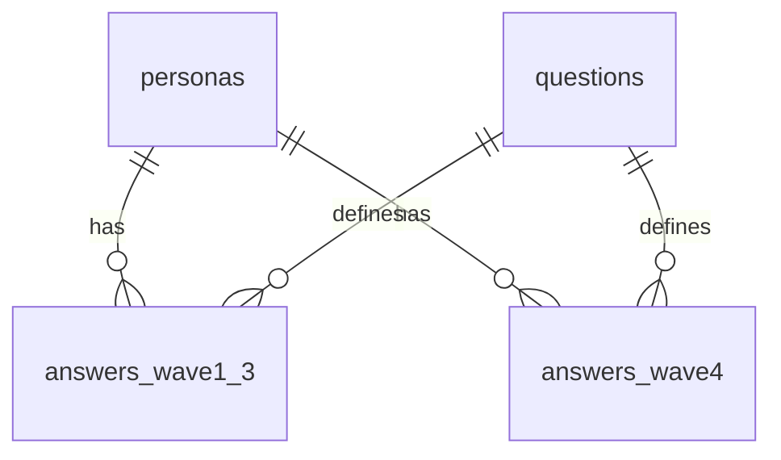

# Twin-2K-500 Ingest Schema

## 1. Overview

SQLite schema for ingesting and querying the [Twin-2K-500 dataset](https://huggingface.co/datasets/LLM-Digital-Twin/Twin-2K-500).

The database is built from the dataset's question catalog, human response CSVs, overlap/mapping files, and `full_persona` configuration.

**Database:** SQLite 3.x

**Objects:**
- Tables: `personas`, `questions`, `answers_wave1_3`, `answers_wave4`
- View: `answers_current`

## 2. Conventions

| Element | Convention |
|---|---|
| `persona_id` | Same as dataset `pid`, stored as `TEXT`. 2,058 distinct values. |
| `item_id` | Stable identifier derived from the question catalog column name (`QID` or `QID_SubID`). |
| Timestamps | ISO 8601 UTC, stored as `TEXT`. |
| JSON | Stored as `TEXT` containing valid JSON. |
| Booleans | Stored as `INTEGER` (`0` or `1`). |

## 3. Entity Relationships



Responses are stored in **long format**, with one row per `(persona_id, item_id)` in each wave table.

The `answers_current` view provides the canonical response for each persona-question pair. Wave 4 takes precedence for questions marked as overlapping.

---

## 4. Tables

### 4.1. `personas`

Stores one record per participant. Demographic attributes support population filtering and segment analysis. `persona_summary` contains the participant description from the Hugging Face `full_persona` configuration.

Individual question responses are stored separately in the answer tables.

**Grain:** One row per participant.

**Expected row count:** 2,058.

**Primary key:** `persona_id`.

| Column | Type | Description |
|---|---|---|
| `persona_id` | `TEXT` | Dataset participant identifier (`pid`). |
| `persona_summary` | `TEXT` | Participant description from `full_persona`. |
| `region` | `TEXT` | US region, such as South or Northeast. |
| `gender` | `TEXT` | Gender. |
| `age_band` | `TEXT` | Age group, such as `18-29`. |
| `education_level` | `TEXT` | Education level. |
| `race` | `TEXT` | Race. |
| `us_citizen` | `INTEGER` | Citizenship indicator: `1` = yes, `0` = no. |
| `marital_status` | `TEXT` | Marital status. |
| `religion` | `TEXT` | Religion. |
| `religious_attendance` | `TEXT` | Religious attendance. |
| `political_affiliation` | `TEXT` | Political affiliation. |
| `income_band` | `TEXT` | Income group. |
| `political_views` | `TEXT` | Political views. |
| `household_size` | `INTEGER` | Household size. |
| `employment_status` | `TEXT` | Employment status. |
| `loaded_at` | `TEXT` | Timestamp when the record was ingested. |
| `source_revision` | `TEXT` | Dataset snapshot or Git revision used for reproducibility. |

**Constraints:**
- `persona_id` is the primary key and cannot be NULL.
- `persona_summary` cannot be NULL.
- `loaded_at` cannot be NULL and defaults to `datetime('now')`.
- `us_citizen` must be `0` or `1` when provided.
- Demographic fields are nullable.

**Indexes:**
- `idx_personas_region_education` on (`region`, `education_level`)
- `idx_personas_age_income` on (`age_band`, `income_band`)

---

### 4.2. `questions`

Stores metadata for each scorable item in the question catalog. Matrix rows, sliders, and single-choice items share the same `item_id` namespace.

**Grain:** One row per catalog column or answer item.

**Expected row count:** Approximately 761 wave 1–3 items, of which approximately 127 were also asked in wave 4.

**Primary key:** `item_id`.

| Column | Type | Description |
|---|---|---|
| `item_id` | `TEXT` | Stable catalog column identifier, such as `QID` or `QID_SubID`. |
| `question_id` | `TEXT` | Qualtrics parent `QuestionID`. |
| `sub_id` | `TEXT` | Sub-item identifier for matrix or slider questions. NULL for single-column questions. |
| `question_text` | `TEXT` | Main question text. May repeat across sub-items. |
| `item_text` | `TEXT` | Row or statement text for matrix questions. |
| `question_type` | `TEXT` | Catalog question type, such as MC, Matrix, or Slider. |
| `options_json` | `TEXT` | JSON array of allowed labels or scale endpoints. |
| `is_overlap` | `INTEGER` | Indicates whether the item was asked again in wave 4. |
| `category` | `TEXT` | Paper or category label from the catalog, when available. |

**Constraints:**
- `item_id` is the primary key and cannot be NULL.
- `question_id` cannot be NULL.
- `is_overlap` cannot be NULL and defaults to `0`.
- `is_overlap` must be `0` or `1`.
- `1` indicates the item appears in both wave 1–3 and wave 4. `0` indicates it appears only in wave 1–3.

**Indexes:**
- `idx_questions_qid` on (`question_id`)
- `idx_questions_overlap` on (`is_overlap`)

---

### 4.3. `answers_wave1_3`

Stores human responses from waves 1–3, sourced from `wave1_3_response.csv` and `wave1_3_response_label.csv`.

**Grain:** One row per participant-question pair.

**Expected row count:** At most 2,058 × approximately 761. Only non-null responses are stored.

**Primary key:** (`persona_id`, `item_id`).

| Column | Type | Description |
|---|---|---|
| `persona_id` | `TEXT` | Participant identifier. |
| `item_id` | `TEXT` | Question item identifier. |
| `value_numeric` | `REAL` | Coded response from the numeric response CSV. |
| `value_label` | `TEXT` | Human-readable response label from the label CSV. |

**Constraints:**
- Composite primary key on (`persona_id`, `item_id`).
- `persona_id` references `personas.persona_id`.
- `item_id` references `questions.item_id`.
- At least one of `value_numeric` or `value_label` must be non-NULL. This is enforced during ingestion.

**Indexes:**
- `idx_answers_w13_item` on (`item_id`)
- `idx_answers_w13_persona` on (`persona_id`)

---

### 4.4. `answers_wave4`

Stores human responses from wave 4. These responses serve as ground truth for wave 4 prediction evaluation.

**Grain:** One row per participant-question pair.

**Expected row count:** At most 2,058 × approximately 127.

**Primary key:** (`persona_id`, `item_id`).

| Column | Type | Description |
|---|---|---|
| `persona_id` | `TEXT` | Participant identifier. |
| `item_id` | `TEXT` | Question item identifier. |
| `value_numeric` | `REAL` | Coded numeric response. |
| `value_label` | `TEXT` | Human-readable response label. |

**Constraints:**
- Composite primary key on (`persona_id`, `item_id`).
- `persona_id` references `personas.persona_id`.
- `item_id` references `questions.item_id`.
- The same foreign key pattern as `answers_wave1_3` applies.

**Indexes:**
- `idx_answers_w4_item` on (`item_id`)
- `idx_answers_w4_persona` on (`persona_id`)

---

## 5. Views

### 5.1. `answers_current`

Provides the canonical human response for each `(persona_id, item_id)` pair.

**Selection logic:**
- Use wave 4 responses when `questions.is_overlap = 1`.
- Use wave 1–3 responses when `questions.is_overlap = 0`.

**Grain:** One row per canonical participant-question response.

**Output columns:**

| Column | Type | Description |
|---|---|---|
| `persona_id` | `TEXT` | Participant identifier. |
| `item_id` | `TEXT` | Question item identifier. |
| `value_numeric` | `REAL` | Coded numeric response. |
| `value_label` | `TEXT` | Human-readable response label. |
| `source_wave` | `TEXT` | Source wave: `'4'` or `'1-3'`. |

**Definition:**

```sql
-- Wave 4 responses for overlapping items
SELECT
    a.persona_id,
    a.item_id,
    a.value_numeric,
    a.value_label,
    '4' AS source_wave
FROM answers_wave4 AS a
JOIN questions AS q
    ON q.item_id = a.item_id
WHERE q.is_overlap = 1

UNION ALL

-- Wave 1–3 responses for items not retested in wave 4
SELECT
    a.persona_id,
    a.item_id,
    a.value_numeric,
    a.value_label,
    '1-3' AS source_wave
FROM answers_wave1_3 AS a
JOIN questions AS q
    ON q.item_id = a.item_id
WHERE q.is_overlap = 0;
```

**Important:** Do not use this view to build training personas for wave 4 evaluation when overlapping answers must remain unseen. Use `answers_wave1_3` or the Hugging Face `wave_split` configuration (`wave1_3_persona_*`) instead.

---

## 6. Ingestion

Load the data in the following order:

1. **`questions`**: Load from `question_catalog.json`. Set `is_overlap` using the `wave4_response.csv` header.
2. **`personas`**: Load `persona_summary` from `full_persona`. Populate demographic attributes from the Hugging Face export or from the answer data after it has been loaded.
3. **`answers_wave1_3` and `answers_wave4`**: Load the human response CSVs in long format.
4. **`answers_current`**: Create the view after loading the underlying tables.

### Source Mapping

| Hugging Face asset | Database destination |
|---|---|
| `full_persona` | `personas` |
| `question_catalog_and_human_response_csv/` | `questions`, `answers_wave1_3`, `answers_wave4` |
| `wave_split` | Optional evaluation split export. Uses the same underlying answers with different packaging. |

---

## 7. SQLite Configuration

Enable foreign key enforcement and write-ahead logging.

```sql
PRAGMA foreign_keys = ON;
PRAGMA journal_mode = WAL;
```